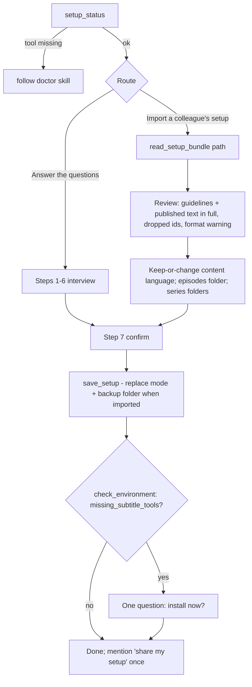

# refactor: Two setup routes, one owner for install help, leaner first run

## Summary

The install / first-run / setup features of 0.8.0–0.8.2 were added one at a time after a live Windows test. The review
fixed the defects; what remains is duplication and a setup flow that asks about helper programs before anything else.
This plan (1) gives setup two equal routes – the interview, or importing a colleague's setup archive – and adds the
missing export, (2) makes `/video2aeo:doctor` the single in-app owner of Python/Git install help, (3) moves the
subtitle-downloader offer to the end of setup, (4) trims the code that grew around it, and (5) rewrites the README
around the shorter flow.

---

## Problem Frame

- The setup wizard is long. A team with one configured colleague should be able to pass that setup on as one file and
  get the same brand, glossary, guidelines, formats and model choices on every computer.
- No export exists. `read_setup_bundle` imports only `brand.json`, `glossary.json`, `guidelines.md`; the per-output
  brand additions in `guidelines/*.md` (read by the episode and wp-article skills and the knowledge-mapper and
  aeo-reviewer agents), switched-off guidelines and model choices are lost. Nothing produces the archive except zipping
  `~/.video2aeo` by hand, which would include `config.json` with the WordPress password and YouTube cookies.
- Python/Git install steps are written in five places (`server/find-python.sh`, `skills/doctor/SKILL.md`,
  `skills/setup/SKILL.md` §0, README twice) and have already drifted (README said "preinstalled" on macOS).
- Setup starts with `check_environment` and a subtitle-tool question before asking anything about the channel.
- The Windows PATH check is read in two places (hook and doctor) by two overlapping PowerShell scripts, and reports
  Git installed via Scoop or as a portable copy as missing.
- `scripts/aeo_lib.py` is ~1,575 lines; setup import and pip helpers were added to it. `check_environment` and
  `fetch_transcript` return several fields that say the same thing.

**Success:** a second teammate with a colleague's archive reaches the first episode answering only the computer-specific
questions (episodes folder, series folders) plus the import review.

---

## Requirements

- R1. `/video2aeo:setup` offers two equal routes at its start: answer the questions, or import a colleague's setup
  archive (.zip or folder). Both end in the same confirmation and save.
- R2. A configured user can export their setup to one .zip ("share my setup") without a terminal.
- R3. The archive carries the team setup – brand (incl. episode formats), glossary, `guidelines.md`, `guidelines/*.md`,
  switched-off guidelines, model choices – and never credentials (`config.json` `wordpress`, `youtube`) or
  computer-specific values (`episodes_root`, backups).
- R4. Import treats the archive as untrusted: the user sees the instruction and published text it brings (guidelines,
  header/footer/promo, links) before saving; it replaces the team items rather than merging into stale ones; it keeps a
  restorable backup of what it replaces; it still asks the computer-specific questions.
- R5. Import tolerates archives from other plugin versions: unknown guideline ids and model ids are dropped and
  reported; a newer archive format is imported with a warning; archives without a manifest (earlier installs, legacy
  `~/.yt-aeo`) import their brand files.
- R6. The subtitle-downloader offer comes at the end of setup (both routes); the offer on fetch failure in
  `/video2aeo:episode` stays.
- R7. In-app Python/Git install help lives only in the doctor skill; setup, the session-start message and the launcher
  message point to it. The README keeps a short pre-install requirements list for people reading it on GitHub.
- R8. One Windows PATH script with a check mode and a fix mode; the hook is the normal place that interprets it, doctor
  reuses the hook and falls back to the script directly when no shell works. Git found in any folder (Scoop, portable)
  is fixable, and only Git's `bin` folder is ever added, to the user PATH.
- R9. No behaviour regressions: stdlib-only Python 3.9, fail-open hook, no blocking hooks, no `bin/`, brand-neutral,
  nothing installed or written to PATH without the user's yes.

---

## Key Technical Decisions

- **Archive = whitelist, with a manifest.** Export writes `video2aeo-setup.json` (archive format version, plugin
  version, export date, `guidelines_off`, `models`) plus `brand.json`, `glossary.json`, `guidelines.md` and
  `guidelines/*.md`. It never reads `config.json` except its `models` key. Rationale: copying the folder would leak the
  WordPress app password and cookies that sit beside `models`. `brand.json` is shared as is; the export result says so.
- **Archive input is untrusted.** The importer reads members in memory with `zipfile` (never extracts), accepts only
  the whitelisted names (top level or one wrapping folder; `__MACOSX/` ignored), rejects `..`, absolute or drive paths
  and symlink members, and caps member count, per-file and total uncompressed size (checked against bytes read).
  Guidelines and published text (header, footer, promo, links) are shown in full at the import review, labelled as
  text the agents will follow or publish. Guidelines can never override the code-enforced rules (principle 5).
- **Import replaces every team item, with one backup folder per import.** `save_setup(replace=True, …)` writes brand,
  glossary, `guidelines.md`, `guidelines/*.md`, `guidelines_off` and `models` exactly as given – an item absent from the
  archive is cleared – after copying the current team files into `backup-<timestamp>/` in the settings folder. All
  input is validated before the first write (as today). Rationale: team consistency; a merge would keep a colleague's
  removed keys, and single `.bak` files would be overwritten by a second import.
- **Tolerant import, strict save.** `read_setup_bundle` filters `guidelines_off` to `ADJUSTABLE_GUIDELINES` and models
  to `config/models.json`, returning what it dropped; `save_setup` keeps rejecting bad input.
- **`setup.json` from an archive is never trusted.** Only `save_setup` writes the `completed` marker, after the user's
  confirmation.
- **`configured` keeps its meaning.** It does not start requiring `episodes_root`; both routes ask for the episodes
  folder before saving and `workspace_status` already explains `no_root`. Rationale: changing `configured` would
  re-trigger setup for every existing user. `setup_status` gains `user_dir_writable` so a read-only settings folder is
  caught before the interview, not at the save.
- **Export location and name:** an absolute existing folder chosen by the user (setup suggests the working folder);
  `video2aeo-setup-<slug>-<yyyy-mm-dd>.zip` with the slug reduced to `[a-z0-9-]`, created with exclusive-create (numeric
  suffix instead of overwriting). Export warns when whitelisted content contains secret-like keys
  (password/token/secret/cookie) or the values of `config.json` `wordpress`/`youtube`.
- **Setup no longer calls `check_environment` first.** `setup_status` working proves Python runs. `check_environment`
  is used at the end of setup (subtitle tools) and by doctor (the helper's real interpreter).
- **Doctor reuses the hook, with a fallback.** The hook already reads the registry PATH via PowerShell; doctor runs
  `sh hooks/check-deps.sh` and reads one fixed line (`video2aeo-path-fix: <folder>`). When no shell works it runs
  `path-check.ps1` with PowerShell directly.
- **Keep the hook's Windows PATH check.** It is reachable: the hook runs through Claude Code's Git Bash while the helper
  starts with the app's registry PATH – the Windows failure seen on 2 Nov 2026.
- **Only Git's `bin` goes on PATH.** A detected `…\Git\usr\bin` (what `command -v sh` returns in Git Bash) is mapped to
  its sibling `…\Git\bin`; the folder must hold `sh.exe` and belong to a Git install (`git.exe` in `bin` or `..\cmd`),
  must not be a UNC path; only the user PATH (HKCU) is written; `-Fix` takes the folder explicitly, which doctor shows
  the user before asking. Rationale: `usr\bin` would put Git's Unix tools in front of Windows `find`/`sort`.
- **New module `scripts/aeo_setup.py`** for setup archive import/export, `check_environment` and the pip helpers.
  `save_setup`/`setup_status` stay in `aeo_lib.py`. `aeo_setup` imports `aeo_lib`, never the reverse; no re-exports.
- **Missing subtitle tools: one field name, defined once.** `missing_subtitle_tools` is a list of package names.
  `check_environment` lists every missing package. `fetch_transcript` includes it only when no tool was usable
  (then it lists both), which is exactly when the install offer makes sense. `optional`, `automatic_subtitles`,
  `platform` and `can_auto_install` go away; the version bump in the release keeps Desktop from mixing old skills with
  the new server.

---

## High-Level Technical Design

Setup after the change (both routes share confirmation, save and the final offer):



Archive layout:

```text
video2aeo-setup-<slug>-<date>.zip
├── video2aeo-setup.json   {archive_format: 1, plugin_version, exported, guidelines_off: [...], models: {...}}
├── brand.json             (incl. format / formats)
├── glossary.json
├── guidelines.md          (optional)
└── guidelines/*.md        (optional, flat; names only [A-Za-z0-9._-]+.md)
```

---

## Implementation Units

### U1. Move setup/environment helpers into `scripts/aeo_setup.py`

**Goal:** Shrink `aeo_lib.py` and give the setup archive code a home, with no behaviour change.

**Requirements:** R9

**Dependencies:** none

**Files:** `scripts/aeo_setup.py` (new), `scripts/aeo_lib.py`, `scripts/aeo_net.py`, `server/server.py`,
`scripts/aeo.py` (if it calls any moved function), `dev/smoke.py`

**Approach:** Move `SUBTITLE_PACKAGES`, `pip_install_args`, `pip_install_command`, `externally_managed`,
`check_environment`, `SETUP_BUNDLE_*`, `read_setup_bundle`. `_unrecognised_keys` and `_expand_dotted` stay in
`aeo_lib` (used by `save_setup`). Update imports in `aeo_net`, `server`, smoke (incl. monkeypatch targets).

**Patterns to follow:** `scripts/aeo_pipeline.py` / `scripts/aeo_net.py` – a module that imports `aeo_lib as L`.

**Test scenarios:** `Test expectation: none -- pure move; the existing smoke checks must pass unchanged apart from
module names.`

**Verification:** smoke passes on 3.14 and 3.9; each of `aeo_lib`, `aeo_setup`, `aeo_net` imports on its own under
3.9; the server answers `tools/list` with every tool.

### U2. Setup archive: export and complete, safe import

**Goal:** A configured user can write a team archive; import restores everything in it, safely and tolerantly.

**Requirements:** R2, R3, R4, R5

**Dependencies:** U1

**Files:** `scripts/aeo_setup.py`, `scripts/aeo_lib.py` (`save_setup` replace mode, `guidelines_files`,
`setup_status.user_dir_writable`), `server/server.py` (`export_setup` tool; `read_setup_bundle` / `save_setup`
descriptions), `dev/smoke.py`

**Approach:**
- `export_setup(out_dir)`: requires `setup_status().configured`; reads the whitelisted user files plus `setup.json`
  `guidelines_off` and `config.json` `models` only; writes the zip to a temp file and renames it into `out_dir`
  (exclusive name); returns the path, what was included, what was deliberately left out, and any secret-like warnings.
- `read_setup_bundle(path)`: archive rules from Key Technical Decisions; also reads the manifest and `guidelines/*.md`;
  returns `guidelines_files`, `guidelines_off`, `models`, `dropped`, `archive_format`, `plugin_version`, `warnings`
  (newer format, several copies of a file, credentials found in an earlier-install folder and not imported); accepts
  UTF-8 with BOM; rejects an empty path. A folder of an earlier install (no manifest) reads `setup.json`
  `guidelines_off` and `config.json` `models` the same way.
- `save_setup(…, guidelines_files=None, replace=False)`: `guidelines_files` maps safe `*.md` names (no separators) to
  text, written into `guidelines/`. With `replace=True` every team item is written as given or cleared, after the
  backup folder is created. Default behaviour unchanged.

**Patterns to follow:** `_write_atomic`, `read_or_set_aside`, `_models_errors` in `scripts/aeo_lib.py`.

**Test scenarios:**
- Round trip: a temp `VIDEO2AEO_HOME` with brand, glossary, `guidelines.md`, `guidelines/youtube-description.md`,
  `guidelines_off`, models, `episodes_root`, and a `config.json` with a fake `wordpress.app_password` and
  `youtube.cookies_file` → export → the zip holds exactly the whitelisted names; its bytes contain neither fake secret
  nor the episodes folder. Import into a second empty home with `replace=True` → `setup_status` equals the original.
- Replace over a fully configured home with a minimal archive (only `brand.json`) → glossary, guidelines files,
  `guidelines_off`, models are cleared; `backup-<timestamp>/` holds the previous files; a second import makes a second
  backup folder and leaves the first intact.
- Unknown guideline id and unknown model alias in the manifest → listed in `dropped`, not returned as values.
- `archive_format: 99` → imported with a warning. No manifest → brand files only, no `guidelines_off`/`models` keys.
- Earlier-install folder with `setup.json` and `config.json` (fake credentials) → `guidelines_off` and models
  imported; warning that credentials were not imported; no secret in the result.
- Hostile zips: member `../x/brand.json`, absolute member name, symlink member, oversized member, 1,000 members →
  each rejected with an error, nothing written. A Finder zip with a wrapping folder and `__MACOSX/` → imports.
- `brand.json` with a UTF-8 BOM imports; empty path → error; export when not configured → error; export twice the same
  day → second file gets a suffix; `brand.json` holding a `password`-named key → export warns.

**Verification:** all scenarios pass in smoke on 3.14 and 3.9; the brand-term grep stays clean.

### U3. Setup skill: two routes, end-of-setup subtitle offer, share step

**Goal:** Setup starts with the route choice and channel questions; helper programs come last.

**Requirements:** R1, R4, R6, R7

**Dependencies:** U2, U4

**Files:** `skills/setup/SKILL.md`, `skills/episode/SKILL.md` (subtitle offer, field name), `server/server.py` (tool
descriptions for `install_subtitle_tools`, `fetch_transcript`)

**Approach:**
- Step 0: call `setup_status`; tool missing or failing → follow the doctor skill, then continue;
  `user_dir_writable` false → stop before the interview with the existing advice. Remove the macOS/Windows install
  bullets and the up-front `check_environment` checklist.
- Route question (when not configured, or when the user asks to import): „Отговарям на въпросите“ / „Внасям
  настройките на колега (.zip или папка)“, with one line: import only archives from a colleague you know. Import path:
  `read_setup_bundle` → review: channel, hosts, formats, glossary count, guidelines switched off, model profile,
  `dropped`, `warnings`, and **in full** the guidelines text and the header/footer/promo and links → keep-or-change of
  the content language (glossary and guidelines are language-specific – say so if the language changes), episodes
  folder, series folders → step 7 confirmation → `save_setup(replace=True, …)`. When already configured: say the
  current team files will be replaced, name the archive's export date and plugin version, and that a backup folder
  is kept (how to undo: run setup and import the backup folder).
- Final step (both routes, after a successful save): `check_environment`; if `missing_subtitle_tools` is not empty, the
  one-question offer (moved from §0, keeping the „no nagging" rule). Then one line that colleagues can get the same
  setup – „кажете ‚сподели настройките‘" (any wording works).
- „Share my setup" (any wording) → `export_setup` with the working folder suggested; tell the user the file path, what
  is in it, that passwords and the episodes folder are not, and that it is private brand material.
- Frontmatter description gains import/export triggers.
- Episode skill: the fetch-failure offer keys off `missing_subtitle_tools` and points to the setup wording instead of
  repeating it.

**Test scenarios:** `Test expectation: none -- skill prose; the tool contract is covered by U2/U4 smoke and the manual
Code-mode run in Verification.`

**Verification:** no Python/Git install steps remain in setup; the full subtitle question text appears once (setup),
the episode skill only points to it; a manual run in Claude Code (`--plugin-dir .`) of both routes reaches the save,
the final offer and an export.

### U4. Leaner environment contract

**Goal:** One defined field for missing subtitle tools; drop redundant `check_environment` output.

**Requirements:** R9

**Dependencies:** U1

**Files:** `scripts/aeo_setup.py`, `scripts/aeo_net.py`, `server/server.py`, `dev/smoke.py`

**Approach:** `check_environment` returns `ok`, `problems`, `python {version, executable, ok}`, `user_dir`,
`user_dir_writable`, `missing_subtitle_tools`, `install_command`. `fetch_transcript` per Key Technical Decisions.
`install_subtitle_tools` output unchanged.

**Test scenarios:**
- `check_environment` keys equal the new set exactly (guards against re-growth).
- Both tools mocked missing → `fetch_transcript` has `missing_subtitle_tools == [both]` and no `can_auto_install`.
- One tool usable but the download fails → no `missing_subtitle_tools` key; manual fallback present.

**Verification:** smoke passes; no `automatic_subtitles` / `can_auto_install` left in skills, server or README.

### U5. Windows PATH: one script, hook interprets, doctor reuses (shippable on its own)

**Goal:** Remove the duplicated PowerShell logic, fix any Git location, never add `usr\bin`.

**Requirements:** R7, R8

**Dependencies:** none (independent of U1–U4; may land first or later)

**Files:** `server/path-check.ps1` (gains `-ShFolder`, `-Fix -Folder`), `server/fix-path.ps1` (deleted),
`hooks/check-deps.sh`, `skills/doctor/SKILL.md`, `dev/smoke.py`, `.claude/CLAUDE.md`

**Approach:**
- `path-check.ps1 [-ShFolder <dir>]` prints `on-path | found:<folder> | git-missing`; `-ShFolder` (Windows path of the
  hook's `sh`) is mapped from `usr\bin` to the sibling `bin`, validated per Key Technical Decisions, and tried before
  the Program Files guesses. `path-check.ps1 -Fix -Folder <dir>` re-validates and appends to HKCU PATH with today's
  raw-registry logic (REG_EXPAND_SZ, case-insensitive duplicate check), printing `added:` / `already-present` /
  `error:`.
- Hook passes `-ShFolder`; on `found:` it prints the plain-words message plus the fixed line
  `video2aeo-path-fix: <folder>`.
- Doctor: §1 runs `sh hooks/check-deps.sh` (Bash tool fails → run `path-check.ps1` directly with PowerShell); a
  `video2aeo-path-fix:` line → show the folder, ask, run `-Fix -Folder`. §2 keeps the only OS table and absorbs §3's
  restart advice and a one-sentence version of §4 (other plugins' hooks).

**Test scenarios:**
- Stubbed MINGW, `powershell.exe` stub answering `found:C:\x\bin` → output contains `video2aeo-path-fix: C:\x\bin` and
  `doctor`; `on-path` → no output; exit 0 in every case (existing cases kept).
- The stub records its arguments: the hook passes `-ShFolder`.
- `release.sh` blocking-hook check unchanged.

**Verification:** smoke passes; manual run on the Windows machine: check mode, `-Fix` on a PATH with a
`%USERPROFILE%` entry (stays unexpanded, type stays REG_EXPAND_SZ), a Scoop-style folder, and that `Git\usr\bin` is
never added.

### U6. Single owner for install help; README and project docs

**Goal:** In-app install help only in doctor; a short user-facing README built around the two setup routes.

**Requirements:** R6, R7

**Dependencies:** U2, U3, U4 (and U5 for the doctor wording if it has landed)

**Files:** `server/find-python.sh` (`python_missing_text`), `hooks/check-deps.sh` (message), `README.md`,
`.claude/CLAUDE.md`, `docs/plugin-build-plan.md` (constraints mirror), `docs/plans/2026-11-02-001-…-plan.md` (status)

**Approach:**
- `python_missing_text`: what is missing, „run /video2aeo:doctor (or see the README), then restart the Claude app",
  and the Code-mode line – enough to stand alone when the helper cannot start.
- README structure: what it does · Requirements (Python 3.9+ with the Windows „Add python.exe to PATH" note; Windows:
  Git for Windows; links) · Install (install plugin; Code mode + new environment + folder; run a command) · First run:
  two ways (answer the questions / import a colleague's `video2aeo-setup-….zip`) · Share your setup · Automatic
  subtitles (one paragraph, offered at the end of setup; manual command; cookies note kept) · Updating · Settings
  files · Developers. Remove the duplicated „Minimal setup" section and the „preinstalled on macOS" claim.
- CLAUDE.md: Layout gains `aeo_setup.py`, `path-check.ps1`; tools gain `export_setup`; Status date and one line for
  this release; „Not yet tested" keeps the Windows/Desktop items.
- Plan 2026-11-02-001: status line notes this follow-up.

**Test scenarios:** `Test expectation: none -- documentation; brand-term grep and claude plugin validate cover it.`

**Verification:** a reader can install and reach the first episode from the README alone; „Add python.exe to PATH"
appears only in the README requirements and the doctor skill.

---

## System-Wide Impact

- **Existing users:** no re-setup; `configured` unchanged. Users who never answered the subtitle question are offered it
  at the end of their next setup run or when an episode needs it.
- **Tool contract:** `check_environment`, `fetch_transcript` fields change and `save_setup` gains arguments; only this
  plugin's skills consume them, updated together; the release bumps the version so Desktop reloads both.
- **Team use:** the archive becomes a shared artefact; its manifest version allows later format changes.

---

## Risks & Dependencies

| Risk | Mitigation |
|---|---|
| A credential ends up in an archive | Whitelist of files and keys; secret-like warning; smoke searches the zip bytes for fake secrets |
| A hostile or careless archive injects instructions or links | Full text shown at review; untrusted-input rules; code-enforced rules cannot be overridden |
| Replace-import discards local tweaks | Backup folder per import; explicit question with the archive's date and version when configured |
| `path-check.ps1 -Fix` untested on Windows here | U5 shippable separately; manual Windows run before its release |
| Skill prose drifts again | Verification greps: install table only in doctor + README; full subtitle question only in setup |

---

## Scope Boundaries

- No tool to save WordPress/YouTube credentials (`config.json` stays hand-edited or env-based).
- No change to the episode pipeline, rendering or validation; the interview questions themselves are not shortened.
- No import from a URL or shared drive – a local path only; no signing of archives.

### Deferred to Follow-Up Work

- Live tests still open from CLAUDE.md (agents + MCP in Desktop Code mode, `fetch_transcript`, `wp_push_draft`).
- Version bump and package (`dev/release.sh`, `dev/package.sh`) after the units land.
